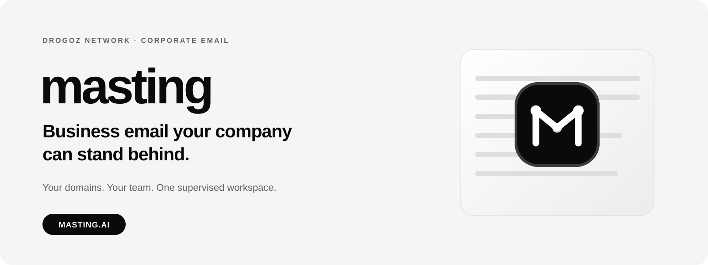
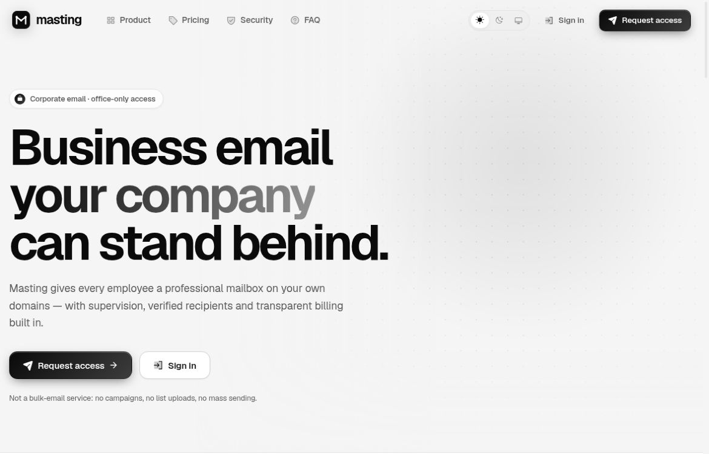
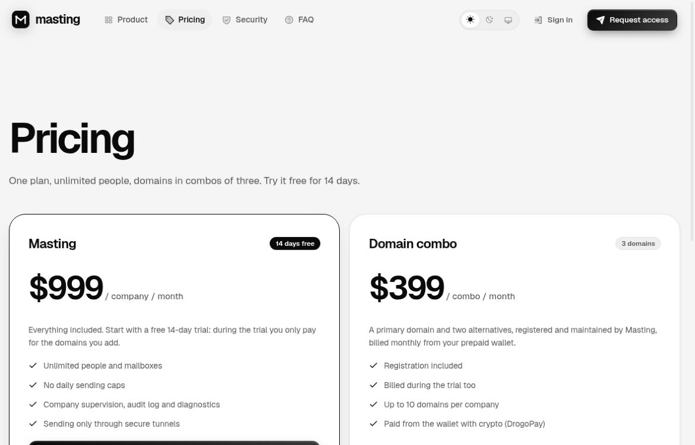
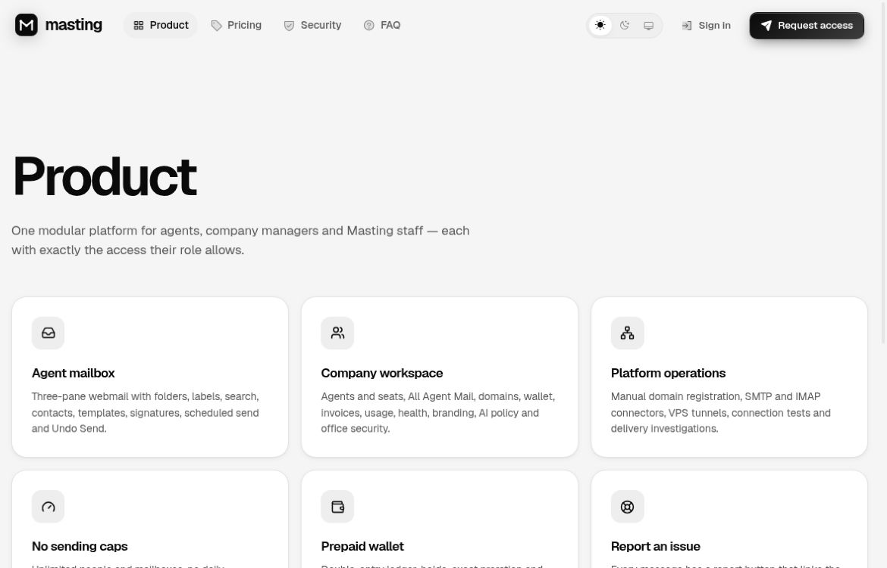
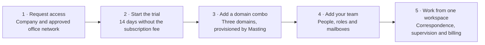

 

# Masting

### Business email your company can stand behind.

  

[Website](https://masting.ai/) · [Product](https://masting.ai/features) · [Pricing](https://masting.ai/pricing) · [Request access](https://masting.ai/signup) · [Telegram](https://t.me/drogoz)

 

<b>This repository is a public product showcase.</b> 
It contains product information, pricing and approved visuals — not the Masting application source code. 
The implementation remains private.

 

## 📋 Contents

- [Overview](#overview)
- [Key features](#key-features)
- [Screenshots](#screenshots)
- [How it works](#how-it-works)
- [Pricing](#pricing)
- [Security and supervision](#security-and-supervision)
- [Who it is for](#who-it-is-for)
- [Product guides](#product-guides)
- [Links](#links)

## 🧭 Overview

**Masting is a corporate email workspace for companies, their teams and the managers responsible for their correspondence.** Employees work from professional mailboxes on company domains. Managers get a supervised company view, while access can be restricted to approved office networks.

The everyday mailbox comes with folders, threads, search, contacts, templates, signatures and scheduled sending. Domain provisioning, recipient checks, delivery diagnostics and prepaid billing belong to the same workflow — not a collection of disconnected tools.

**Masting is not a bulk-email or marketing platform.** It has no campaigns, list uploads, mail merges or bulk-send APIs. It is built for lawful business correspondence.

| At a glance | |
|---|---|
| **Product** | Corporate webmail and team supervision |
| **Website** | [masting.ai](https://masting.ai/) |
| **People and mailboxes** | Unlimited under the Masting plan |
| **Subscription** | $999 per company per month after a 14-day trial |
| **Domains** | $399 per three-domain combo per month, billed separately |
| **Source code** | Private — this is a presentation repository |

## ✨ Key features

### 📬 A real business mailbox

- **Three-pane webmail** with Inbox, Sent, Drafts, Scheduled, Archive, Spam and Trash.
- **Threads, search, labels and contacts** to keep correspondence organized.
- **Templates and signatures** for consistent company communication.
- **Attachments, replies, reply-all and forwarding** in the same workspace.
- **Scheduled send and an Undo Send window** before a message is submitted.

### 👥 One team, a supervised workspace

- **Unlimited people and mailboxes** under one company subscription.
- **Company roles and access controls** for agents, managers and owners.
- **All Agent Mail** brings the team's correspondence into a company-wide view.
- **Audited supervision**: opening a message as a supervisor does not mark it read for the agent.
- **Company branding, templates and signatures** alongside team management.

### 🛡️ Controlled access and sending

- **Approved office networks** can define who may enter the authenticated workspace.
- **Recipient verification** is part of the sending workflow; risky addresses require acknowledgement and suppressed recipients are blocked.
- **Tunnel-based sending**: routes that require a secure tunnel fail closed rather than silently switching to a direct connection.
- **Delivery diagnostics with honest status**: SMTP acceptance is not presented as proof that a message reached the inbox.
- **Message-linked issue reports** help support investigate the relevant message and delivery evidence.

### 🌐 Domains and billing in one place

- **Three-domain combos**: a primary domain and two alternatives, with registration included in the combo price.
- **Managed provisioning**: the Masting team handles domain registration and configuration.
- **A prepaid USD wallet**, billing history and itemized invoices.
- **No daily sending caps under the standard plan** — still subject to recipient controls, service policies and provider constraints.
- **Payment pauses without deletion**: the company is paused on unpaid monthly charges and resumes when funding covers the amount due.

## 🖼️ Screenshots

Current public-site captures are included below. They show the product presentation and published prices, not private customer correspondence or production administration.

<table>
<tr><td colspan="2" align="center"> Corporate email, team supervision and approved-network access</td></tr>
<tr>
<td width="50%" align="center"> Published pricing — captured October 30, 2026</td>
<td width="50%" align="center"> Mailboxes, company workspace and managed operations</td>
</tr>
</table>

> These are unaltered public-page captures. References to optional integrations in the interface do not establish that those integrations are enabled. Confirm current payment methods and optional capabilities with the team.

## ⚙️ How it works

Domain charges apply during the trial. Requesting names does not itself register or reserve them; provisioning is handled by the Masting team.

## 💳 Pricing

One company plan. No per-seat subscription fee. Domains are billed separately.

| Item | Price | What it covers |
|---|---:|---|
| **Masting plan** | **$999 / company / month** | Unlimited people and mailboxes; no daily sending caps under the standard plan |
| **Subscription trial** | **14 days** | The company subscription fee is waived; domain combos remain chargeable |
| **Domain combo** | **$399 / combo / month** | Three domains: one primary and two alternatives; registration included |

### Example monthly totals

| Domain combos | Domains | During the subscription trial¹ | After the trial |
|---:|---:|---:|---:|
| 1 | 3 | $399 / month | **$1,398 / month** |
| 2 | 6 | $798 / month | **$1,797 / month** |
| 3 | 9 | $1,197 / month | **$2,196 / month** |

¹ The trial waives the subscription, **not** the recurring domain fee. These are monthly recurring amounts, not a prorated 14-day quote.

- **Taxes are not included.**
- The published company limit is **up to 10 domains**. Combos are sold in sets of three; confirm any arrangement outside complete combos with Masting.
- Billing uses a **prepaid USD wallet**. Confirm currently available funding methods with the team during onboarding.
- If monthly charges cannot be collected, the workspace is paused rather than deleted. Access resumes when sufficient funds cover the outstanding charges.
- Prices checked on **October 30, 2026**. The [live pricing page](https://masting.ai/pricing) and your service terms govern your purchase.

See [Pricing and billing](docs/pricing.md) for the full explanation.

## 🔐 Security and supervision

Masting is designed for **supervised business communication**, not private end-to-end encrypted messaging.

| Control | What it means |
|---|---|
| **Company isolation** | Organization-scoped access with database-level row isolation |
| **Office-network controls** | Access from approved IPv4/IPv6 networks; an approved VPN exit can also be reached remotely |
| **Role-based access** | Different permissions for company staff and platform operators |
| **Audited supervision** | Managers can view company mail; privileged platform access is audited |
| **Safer email display** | Sanitized HTML in a sandboxed frame, remote images blocked by default, and risky-attachment handling |
| **Server-side credentials** | Connection credentials are encrypted at rest and are not sent to browsers |

Two-factor authentication is a configurable platform capability; **this showcase does not claim that it is enabled or mandatory for every deployed role**.

No inbox-placement guarantee, uptime promise, compliance certification or end-to-end encryption claim is made here. See the [security overview](https://masting.ai/security) and [security guide](docs/security-and-privacy.md).

## 🎯 Who it is for

- **Companies with shared operating standards** — professional mailboxes, signatures and templates under one subscription.
- **Managers responsible for team correspondence** — supervised visibility without changing an agent's read state.
- **Office-based teams** — access policies tied to approved networks.
- **Organizations that want managed domain provisioning** — domain setup and mailbox operations in one service.

For bulk campaigns and email marketing, Masting is not the right product.

## 📘 Product guides

| Guide | What it covers |
|---|---|
| [Product guide](docs/product-guide.md) | Workspaces, roles and the path from onboarding to daily correspondence |
| [Pricing and billing](docs/pricing.md) | Trial, subscription, domain combos, example totals and payment pauses |
| [Security and privacy](docs/security-and-privacy.md) | Access boundaries, supervision and what is not promised |
| [FAQ](docs/faq.md) | Clear answers about use, access, domains, pricing and source availability |

AI writing tools, AI autoreplies and automated crypto top-ups are **not represented here as currently active launch features**. Availability of optional integrations should be confirmed with Masting.

## 🔗 Links

| Channel | Link |
|---|---|
| **Website** | [masting.ai](https://masting.ai/) |
| **Product** | [Features](https://masting.ai/features) · [Pricing](https://masting.ai/pricing) · [Security](https://masting.ai/security) · [FAQ](https://masting.ai/faq) |
| **Workspace** | [Request access](https://masting.ai/signup) · [Sign in](https://masting.ai/login) |
| **Contact / demonstration** | [Drogoz on Telegram](https://t.me/drogoz) |
| **Network** | [Drogoz Network](https://drogoz.network/) · [GitHub profile](https://github.com/deepdrogo/deepdrogo) |
| **Legal** | [Terms](https://masting.ai/legal/terms) · [Acceptable use](https://masting.ai/legal/acceptable-use) · [Privacy](https://masting.ai/legal/privacy) · [Refunds](https://masting.ai/legal/refunds) · [Disclaimer](https://masting.ai/legal/disclaimer) · [Compliance](https://masting.ai/legal/compliance) |

 

**Masting · Part of [Drogoz Network](https://drogoz.network/)**

[Website](https://masting.ai/) · [Telegram](https://t.me/drogoz) · [Back to the network profile](https://github.com/deepdrogo/deepdrogo)

© 2026 Masting. All rights reserved. 
Provided for lawful business correspondence only. Customers are responsible for their use of the service. 
This public showcase does not grant a license to the private application source code.

